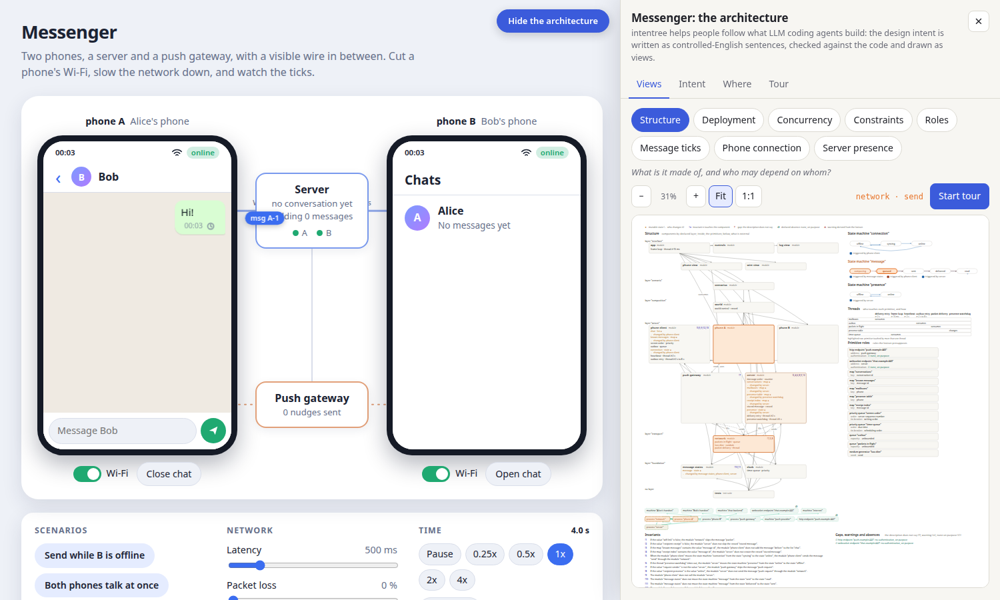

# intentree

Helps people follow what LLM coding agents build.

Agents record a project's design intent as sentences in controlled English: strict enough
for a deterministic parser, plain enough to read as notes. intentree compares the sentences
with what it can find in the code and draws them as several views, so it is easier to see
what was built and where it drifted from what was meant.

```
The process "api" listens on the tcp endpoint "server:8993".
The module "cache" never writes the file "index.json". ^src/cache.rs#flush
If the queue "outbox" is empty, the thread "retry" waits for the event "reconnect".
```

It is a lens, not a proof. It reports the mismatches it is able to detect (a sentence it
cannot read, an anchor that points at nothing, code that no sentence mentions) and it
leaves everything else to you. A sentence that checks is only as true as what it describes.

## Try it

Two interactive demos run in the browser, each with the real intentree (compiled to
WebAssembly) beside the simulator, showing the views of the demo's own code. You can edit
its `.intent` live and ask "where would I change...?" like a coding agent would.

- **Messenger**: two phones, a server and a push gateway; cut a phone's Wi-Fi and watch the
  ticks. [`examples/messenger`](examples/messenger)
- **Parking garage**: two entries, an exit, a payment kiosk and a controller racing for the
  last free space. [`examples/parking`](examples/parking)



Locally (the `.wasm` is built, not committed):

```bash
bash scripts/build-wasm.sh        # needs the wasm32-unknown-unknown Rust target
python3 -m http.server            # then open http://localhost:8000/
```

## Install

```bash
cargo install --path .            # or: cargo build --release
```

There are no dependencies besides the Rust standard library.

## Use

Put `.intent` files at the root of your project (or in an `intent/` folder), then:

```bash
intentree check            # every sentence parses, every anchor exists; coverage and gaps
intentree where <words>    # where to change: ranked components, files, symbols, nearby rules
intentree show <file>      # what the .intent says about one file
intentree view structure --format svg > structure.svg
intentree views            # the catalog of views
intentree facts            # what the code reveals that the .intent does not say yet
intentree coverage         # how much of the project the sentences account for
intentree stale            # sentences to review after code changes
intentree lexicon          # the words the format accepts
```

`ir` prints the intermediate representation as JSON and `canon` prints canonical sentences.
Add `--file X.intent` to read a single file, and `-C <dir>` to run somewhere else.

Writing guide: [FORMAT.md](FORMAT.md). A complete small example to read:
[`examples/elevator/system.intent`](examples/elevator/system.intent).

### Views

| View | The question it answers |
|---|---|
| `structure` | What is it made of, and which layer does each piece live in? |
| `deployment` | Where does each piece run, and who talks to whom? |
| `concurrency` | What runs at the same time, and what state do they share? |
| `constraints` | Which rules hold, and what code enforces each one? |
| `roles` | What did each generic piece (queue, endpoint, field) have to say about itself? |
| `machine:<name>` | Which states does this thing go through? |

You can also declare your own views in the `.intent` file (see FORMAT.md).

## Using it with coding agents

intentree is built mainly for LLM coding agents, and its output is sized for them: `where`
answers in at most 2.5 KB, a word outside the lexicon becomes a pending proposal that only a
human can approve, and `check` reports each problem in one line with a hint. The suggested
workflow lives in [AGENTS.md](AGENTS.md); copy it into the instructions file your agent reads.

## Other languages

English is the only supported language for sentences. As a worked example of porting the
output, `--pt` renders canonical sentences and views in Portuguese using the `pt:` and `g:`
fields of the lexicon (`src/intent/lexicon.txt`). Entries without a `pt:` label fall back to
English.

## Development

```bash
cargo test                  # unit and integration tests
cargo run -- check          # intentree describes itself in intentree.intent
node web/test-wasm.mjs      # the wasm build agrees with the native one
```

See [CONTRIBUTING.md](CONTRIBUTING.md).

## License

Apache License 2.0. See [LICENSE](LICENSE) and [NOTICE](NOTICE).
